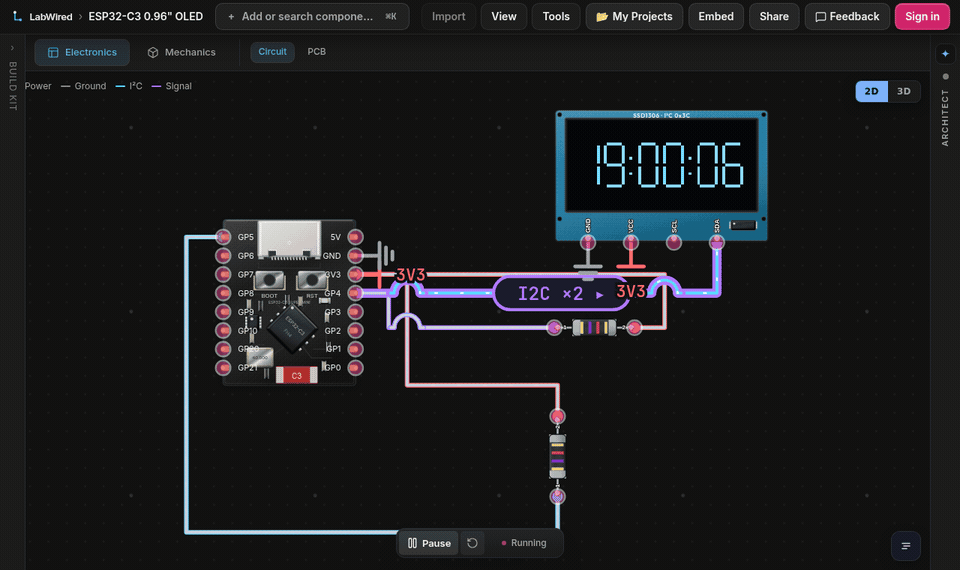
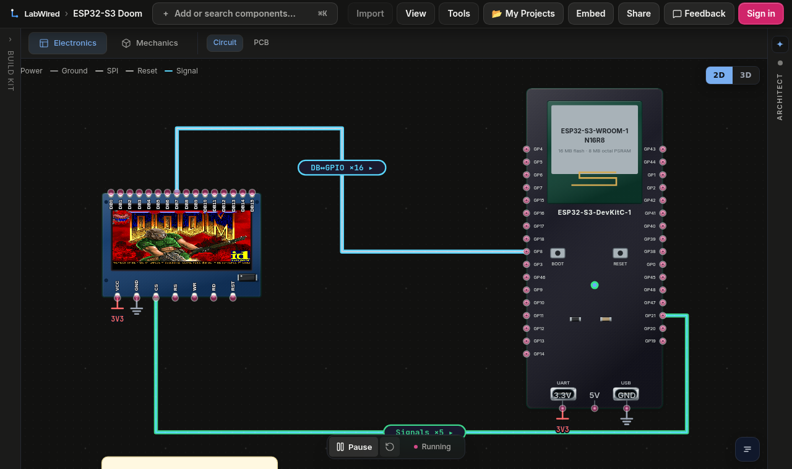
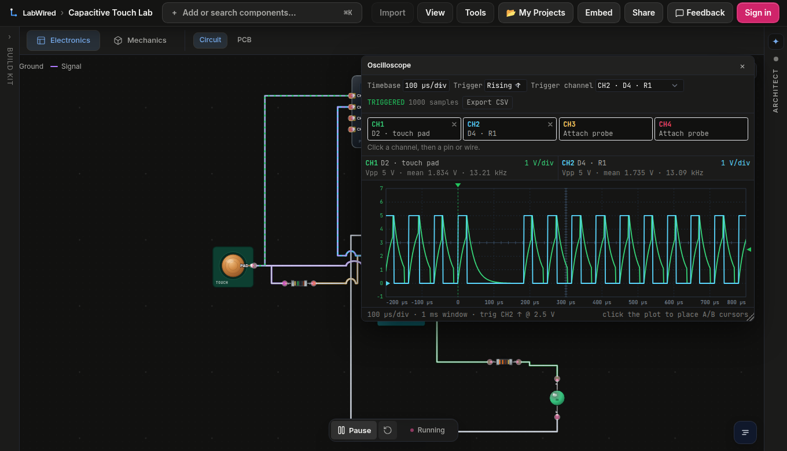
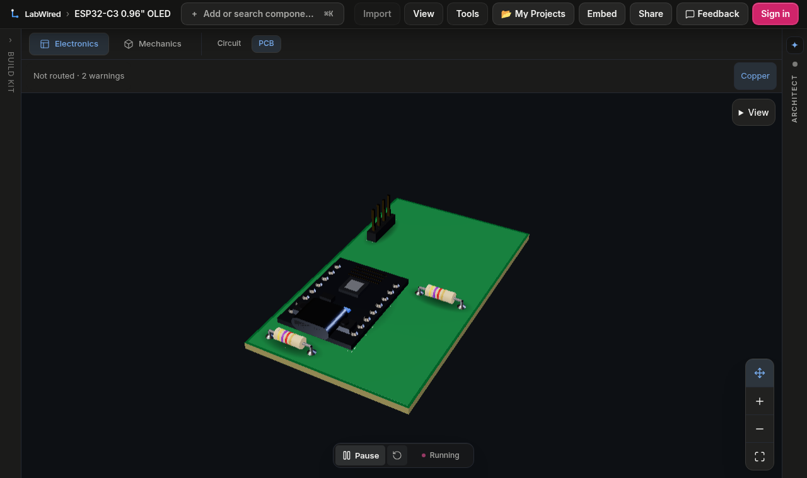

<a href="https://labwired.com">
  <picture>
    <source media="(prefers-color-scheme: dark)" srcset="https://raw.githubusercontent.com/w1ne/labwired-core/main/docs/assets/brand/labwired-logo-dark.png">
    
  </picture>
</a>

# LabWired Core

Run unmodified ARM, RISC-V, and Xtensa firmware against modeled silicon, circuits, and boards — in your browser, terminal, CI, or AI coding agent.

[](https://github.com/w1ne/labwired-core/actions/workflows/core-ci.yml)
[](https://github.com/w1ne/labwired-core/actions/workflows/core-board-ci.yml)
[](https://github.com/w1ne/labwired-core/actions/workflows/core-validate-hw-targets.yml)
[](https://github.com/w1ne/labwired-core/releases/latest)
[](https://labwired.com/)
[](https://docs.labwired.com/)
[](LICENSE)

> **`ERC 0/0` · `DRC 0/0` · `4/4 firmware checks` · `19,033/19,033 SPI transfers matched vs physical silicon` · `193–403 Minsn/s RV32 block cache`**

## Try in your browser — zero login, click Run

Every link below boots real compiled firmware directly in WebAssembly with **no account or install required**:

| Demo | What runs live | 1-Click Launch |
| --- | --- | --- |
| **ESP32-S3 DOOM** | ESP32-S3-WROOM-1 (N16R8) driving a 16-bit parallel LCD framebuffer (`DB0–DB15`) | [**Open & Run ↗**](https://app.labwired.com/?lab=esp32s3-doom-lab&run=1) |
| **ESP32-C3 OLED Clock + 3D PCB** | ESP32-C3 Super Mini running real firmware over live I²C (`0x3C`) + interactive 3D board view | [**Open & Run ↗**](https://app.labwired.com/?lab=esp32c3-oled-lab&run=1) |
| **Mixed-Signal Touch + Oscilloscope** | Arduino Nano + 1 MΩ RC touch pad + live 4-channel oscilloscope plotting real RC decay (`13.2 kHz`) | [**Open & Run ↗**](https://app.labwired.com/?lab=capacitive-touch-lab&run=1) |
| **20-Axis Robot & 3D Printer Twin** | ESP32-C3 20-servo robot (`axiom-h1-robot`) & STM32F411 4-axis printer (`a1-mini-printer`) wired to KernelCAD 3D | [**Robot ↗**](https://app.labwired.com/?lab=axiom-h1-robot&run=1) · [**3D Printer ↗**](https://app.labwired.com/?lab=a1-mini-printer&run=1) |

<table>
  <tr>
    <td width="50%">
      <a href="https://app.labwired.com/?lab=esp32c3-oled-lab&run=1">
        
      </a>
      <sub><b>ESP32-C3 + SSD1306 OLED (live GIF):</b> real RV32 firmware ticking over animated I²C bus — zero login.</sub>
    </td>
    <td width="50%">
      <a href="https://app.labwired.com/?lab=esp32s3-doom-lab&run=1">
        
      </a>
      <sub><b>ESP32-S3 DOOM:</b> N16R8 driving a 16-bit parallel TFT LCD in WebAssembly — zero login.</sub>
    </td>
  </tr>
  <tr>
    <td width="50%">
      <a href="https://app.labwired.com/?lab=capacitive-touch-lab&run=1">
        
      </a>
      <sub><b>Mixed-signal + Oscilloscope:</b> live CH2 drive pulse + CH1 analog RC exponential decay (<code>13.2 kHz</code>).</sub>
    </td>
    <td width="50%">
      <a href="https://app.labwired.com/?lab=esp32c3-oled-lab&run=1">
        
      </a>
      <sub><b>Board → 3D PCB / KernelCAD:</b> switch to PCB &amp; 3D while the exact same firmware keeps running.</sub>
    </td>
  </tr>
</table>

<sub>More zero-login labs: <a href="https://app.labwired.com/?lab=epaper-weather-station&run=1">ESP32-C3 tri-color e-paper weather</a> · <a href="https://app.labwired.com/?lab=nucleo-u575-star-catcher&run=1">STM32U575 Star Catcher</a> · <a href="https://app.labwired.com/?lab=bme280-weather-lab&run=1">BME280 weather</a> · <a href="https://app.labwired.com/?lab=iolink-dido&run=1">IO-Link DI/DO</a></sub>

## Architecture

```text
  Firmware ELF / Bin ──┐   KiCad (.kicad_sch/.kicad_pcb) / Wokwi (diagram.json) / YAML
                       ▼
  ┌──────────────────────────────────────────────────────────────────────────────────┐
  │  CPU Cores: ARM Cortex-M0+/M3/M4/M7/M33 · RISC-V (Rv32BlockCache + Wasm JIT)     │
  │             Xtensa LX6/LX7 (ESP32/S3 paths) · AVR                                │
  ├──────────────────────────────────────────────────────────────────────────────────┤
  │  Deterministic System Bus & Event Scheduler                                      │
  │  ├─ Silicon peripherals (UART, SPI, I2C, CAN, USB, DMA, Timers, ADC, PWM, Radio) │
  │  ├─ Board devices (OLED/TFT/e-paper framebuffers, IMUs, Flash, IO-Link, Servos)  │
  │  └─ Mixed-signal analog solver (browser linear RLC + native ngspice co-sim)      │
  └──────────────────────────────────────────────────────────────────────────────────┘
                       │
      ┌────────────────┼─────────────────┬──────────────────┬─────────────────┐
      ▼                ▼                 ▼                  ▼                 ▼
   CLI Gate      GitHub Action       Python SDK       Browser WASM       MCP Server
 (labwired test) (labwired-core@v1) (labwired.Sim)   (app.labwired.com) (Claude/Codex)
```

## What is LabWired Core?

LabWired Core loads an unmodified firmware ELF and executes it deterministically against modeled silicon and board hardware: CPU, buses, peripherals, sensors, displays, and protocol devices. The same ELF and board manifest produce the same UART log, GPIO/bus trace, and pass/fail exit code on every machine.

Two design choices separate it from a bare CPU emulator:

1. **The board is modeled, not only the chip.** Sensors, displays, analog RC networks, and bus devices live in declarative YAML manifests (`configs/chips/`, `configs/systems/`). You assert on I²C traffic, SPI transfers, GPIO pin state, or framebuffer output.
2. **Thin spots are published.** Every target sits in a named validation tier (`Modeled`, `Smoke-tested`, `Hardware-compared`). Shortcuts are documented in [`FIDELITY.md`](FIDELITY.md).

For analog circuits and KiCad boards, see the [online circuit simulator guide](https://labwired.com/circuit-simulator/) (browser linear RLC + native `ngspice` co-simulation) and the [KiCad PCB import guide](https://labwired.com/kicad-pcb-simulation/).

## Performance Benchmarks

Measured on Linux x86_64 with `cargo test -p labwired-core --release --features "jit-framework,jit"` (see [`docs/esp32sim-audit.md`](docs/esp32sim-audit.md) for methodology, differential tests, and MIT attribution to [`mikroverk/esp32sim`](https://github.com/mikroverk/esp32sim)):

| Workload | Baseline interpreter | `Rv32BlockCache` (native & browser WASM32) | `RiscvWasmJit` (shared `Store`+`Memory`) |
| --- | ---: | ---: | ---: |
| ESP32 512 KiB SRAM ALU + mem + branch (2M instrs) | 35.8 Minsn/s (55.9 ms) | **193.8 Minsn/s** (10.3 ms, **5.42×**) | **85.8 Minsn/s** (23.3 ms, **2.40×**) |
| RV32IM pure ALU self-loop (2M instrs) | 69.8 Minsn/s (28.6 ms) | **402.9 Minsn/s** (5.0 ms, **5.77×**) | 59.8 Minsn/s (33.5 ms, 0.86×) |
| Short 256 B SRAM `step_unit` vs `Machine::step` (1M instrs) | 5.32 Minsn/s (187.8 ms) | — | **153.6 Minsn/s** (6.5 ms, **28.85×**) |

Reproduce locally:

```sh
cargo test -p labwired-core --release --features "jit-framework,jit" \
  --test riscv_block_cache_and_shared_jit_bench -- --include-ignored --nocapture
```

## Quickstart (CLI)


<sub>Recorded from [`docs/assets/demo.tape`](docs/assets/demo.tape) against a real binary. The second half breaks an assertion on purpose so you can see the CI gate fail.</sub>

Clone the repository, install the CLI, and run a committed bare-metal ELF — no cross-toolchain needed:

```sh
git clone https://github.com/w1ne/labwired-core && cd labwired-core
curl -fsSL https://labwired.com/install.sh | LABWIRED_VERSION=v0.26.0 sh
labwired test --script examples/nrf54l15-dk/io-smoke.yaml
```

```
nRF54L15 boot OK
core=cortex-m33 rram=1524K ram=256K
uarte20@0x500C6000 gpio2@0x50050400
regs from MDK/SVD, not nRF52
PASS  4/4 checks · io-smoke · 200000 steps · 0.04s
```

That is a committed bare-metal ELF booting on an nRF54L15-DK profile in under a second.
Nothing is compiled on your machine.

The four checks are the three UART lines plus the stop reason.

The firmware prints those lines from string literals. The text proves nothing by itself.
What it proves is that the bytes arrived. To send them, the firmware had to boot from RRAM
at `0x0`, set up RAM at `0x20000000`, and drive UARTE20 over EasyDMA. Get the UARTE base
wrong in the chip model and you get no output at all.

GPIO is checked at the pin, not in the banner, by
`firmware_survival::test_nrf54l15_lights_dk_led0`. The
[example README](examples/nrf54l15-dk/README.md) says why both tests are needed.

The verdict goes to stderr. The exit code is the gate: `0` passes, anything else fails.
UART output and `--json` stay on stdout, so pipes keep working.

## GitHub Action (`uses: w1ne/labwired-core@v1`)

Run LabWired hardware & firmware verification on every pull request in public repositories at zero cost — no API keys or secrets required:

```yaml
name: LabWired Verify
on: [pull_request, push]

permissions:
  contents: read
  pull-requests: write
  id-token: write

jobs:
  verify:
    runs-on: ubuntu-latest
    steps:
      - uses: actions/checkout@v4
      - uses: w1ne/labwired-core@v1
```

Auto-detects unmodified Wokwi `diagram.json` projects, KiCad `.kicad_pcb`/`.kicad_sch` boards, and LabWired test scripts (`tests/labwired.yml`), runs ERC + PCB DRC + deterministic firmware assertions, and posts a PR check summary (`ERC 0/0 · DRC 0/0 · X/X firmware assertions passed`) with a shareable replay link and `Verified by LabWired` badge. See [`action/README.md`](action/README.md) and the drop-in samples in [`examples/ci-wokwi-dropin`](examples/ci-wokwi-dropin) and [`examples/ci-kicad-dropin`](examples/ci-kicad-dropin).

## Installation

The install script covers Linux, macOS, and Windows via WSL2.

```sh
curl -fsSL https://labwired.com/install.sh | LABWIRED_VERSION=v0.26.0 sh
```

| Variable | Effect |
| --- | --- |
| `LABWIRED_VERSION=` | pin a release |
| `LABWIRED_INSTALL_DIR=` | choose the install directory |
| `LABWIRED_FROM_SOURCE=1` | build from source instead of downloading |

To read the installer before running it:

```sh
curl -fsSL https://labwired.com/install.sh -o install.sh   # review it, then:
sh install.sh
```

### Windows

The native Windows archive contains `labwired.exe` and `labwired-dap.exe`.
Install the current [x64 Microsoft Visual C++ v14 Redistributable](https://aka.ms/vc14/vc_redist.x64.exe)
first; both executables require `VCRUNTIME140.dll`. See Microsoft's
[runtime requirements](https://learn.microsoft.com/en-us/cpp/windows/latest-supported-vc-redist?view=msvc-170)
for supported Windows versions.

Download and extract the archive in PowerShell with `tar` available:

```powershell
$v = "v0.26.0"
Invoke-WebRequest "https://github.com/w1ne/labwired-core/releases/download/$v/labwired-$v-windows-x86_64.tar.gz" -OutFile labwired.tar.gz
mkdir $env:LOCALAPPDATA\LabWired -Force
tar -xzf labwired.tar.gz -C $env:LOCALAPPDATA\LabWired
$env:PATH += ";$env:LOCALAPPDATA\LabWired"
labwired --version
```

The VS Code extension does this for you on Windows — it downloads the same
archive on first use. WSL2 also works and takes the Linux instructions above.

Or build it yourself:

```sh
cargo build --release -p labwired-cli
```

## Running LabWired

### From your terminal

```sh
labwired run  --chip configs/chips/<chip>.yaml --firmware path/to/firmware.elf
labwired test --script  path/to/test.yaml --junit report.xml
```

`run` is interactive: UART, GPIO, traces, snapshots.

`test` is the gate. It writes `result.json`, `uart.log`, and JUnit, and returns an exit code.
Assertions cover UART content, memory and register values, stop reasons, and step and
wall-time limits.

See the [CLI reference](docs/cli_reference.md) and the
[test runner reference](docs/ci_test_runner.md).

### From Python

Install the SDK from PyPI with Python 3.9 or later:

```sh
python -m pip install 'labwired[test]==0.26.0'
```

Use `labwired.Sim` to run an ELF, wait for UART output, and write pytest checks:

```python
from labwired import Sim

with Sim("tests/fixtures/uart-ok-thumbv7m.elf",
         chip="ci-fixture-cortex-m3-uart1", uart="uart1") as sim:
    sim.expect("OK", timeout="1ms")
```

The SDK runs the Rust engine in your Python process. See the
[Python SDK quickstart](docs/python-sdk.md) for source-build instructions and a
runnable pytest test using the repository's firmware fixture.

### In CI

The same YAML scripts are the merge gate, with no HIL bench to maintain:

```yaml
- run: labwired test --script examples/ci/uart-ok.yaml --junit report.xml
```

See [CI integration](docs/ci_integration.md) and
[labwired.com/ci](https://labwired.com/ci.html).

### From an AI coding agent (MCP + Agent Skills)

LabWired speaks MCP and ships official Agent Skills + a Claude Code plugin directly inside this repository (`w1ne/labwired-core`). An agent can assemble a board, compile and simulate firmware, verify behavior, price a BOM, route a KiCad PCB, and read the evidence back — without touching a local toolchain.

For 1-click setup across Claude Code, Codex, Cursor, ChatGPT, VS Code Copilot, and Gemini CLI, visit **[app.labwired.com/tools/mcp](https://app.labwired.com/tools/mcp)** — or run directly:

```sh
# 1. Connect hosted MCP (OAuth 2.1, free daily tier)
claude mcp add --transport http labwired https://api.labwired.com/mcp
codex  mcp add labwired --url https://api.labwired.com/mcp

# 2. Install the official Claude Code plugin + Agent Skills from w1ne/labwired-core
claude plugin marketplace add w1ne/labwired-core
claude plugin install labwired@labwired

# Or install the Agent Skills into any agent via the universal CLI
npx skills add w1ne/labwired-core
```

Bundled skills in [`plugins/labwired/`](plugins/labwired/README.md) (with live proof in [`plugins/labwired/proof/`](plugins/labwired/proof/README.md)):

- [`electronics-lab`](plugins/labwired/skills/electronics-lab/SKILL.md) — default turnkey circuit, firmware, and PCB workflow
- [`build-and-verify-hardware`](plugins/labwired/skills/build-and-verify-hardware/SKILL.md) — prompt to verified circuit, firmware, BOM pricing, PCB, and 3D enclosure
- [`debug-firmware-in-sim`](plugins/labwired/skills/debug-firmware-in-sim/SKILL.md) — deterministic firmware debugging via UART, GPIO, bus traces, and interactive stepping
- [`verify-ci-regression`](plugins/labwired/skills/verify-ci-regression/SKILL.md) — deterministic pass/fail hardware verification oracles for GitHub Actions CI
- [`export-kicad-and-bom`](plugins/labwired/skills/export-kicad-and-bom/SKILL.md) — KiCad schematics/PCBs, Gerbers/CPL, priced BOMs, and STEP enclosures
- [`audit-erc-drc-and-safety`](plugins/labwired/skills/audit-erc-drc-and-safety/SKILL.md) — pre-fab ERC/DRC, signal integrity, thermal/pin-limit, and fault-injection audits

Your client opens a browser to sign in on first use. Other MCP clients take the standard
block:

```json
{ "mcpServers": { "labwired": { "type": "http", "url": "https://api.labwired.com/mcp" } } }
```

Then ask for what you want:

> *"Connect LabWired over MCP. Load a virtual STM32 LED + UART board, run the firmware,
> check the UART output, and give me the Playground URL."*

Agents working inside this repository should read [docs/agents.md](docs/agents.md).

## How a board is described

A board is data, not code.

A chip descriptor in [`configs/chips`](configs/chips/) declares memory geometry, cores, and
peripheral bases. A system manifest in [`configs/systems`](configs/systems/) wires up pins,
buses, and the devices on them. Firmware writes to modeled registers. The modeled hardware
drives the firmware back.

To add a board you write those two files and an example. You do not patch the engine. See
the [board onboarding playbook](docs/board_onboarding_playbook.md) and the
[configuration reference](docs/configuration_reference.md).

## What we validate

Every capability sits in one of three tiers, and we say which:

* **Modeled** — simulator logic exists and firmware can execute against it.
* **Smoke-tested** — a committed test or example exercises the model and checks output.
* **Hardware-compared** — captured silicon behavior is diffed against simulator behavior for
  a documented scope.

The NUCLEO-H563ZI example is the reference case. The same firmware runs on a physical board
and on the simulator, and the artifacts are committed. See
[`VALIDATION.md`](examples/nucleo-h563zi/VALIDATION.md),
[`determinism_report_h563.json`](examples/nucleo-h563zi/golden-reference/determinism_report_h563.json),
and the [golden reference method](docs/golden_reference.md).

Each report covers the scope it describes. None of them claim that every instruction and
timing path matches silicon. The [Fidelity Ledger](FIDELITY.md) has both sides: where we
short-circuit hardware, and where we hold up. One e-paper panel matches silicon on 19033 of
19033 SPI transfers.

## Boards and examples

ARM Cortex-M and RISC-V have the deepest coverage. Some ESP32/Xtensa paths exist for
specific examples. The optional native [QEMU-derived Cortex-A7 backend](docs/qemu-arm-core.md)
runs bounded instruction fixtures through the same CPU and bus interfaces. The
[Luckfox Pico Mini A dossier](docs/boards/luckfox-pico-mini-a.md) includes vendor assets,
pins and declared memory geometry; RV1103 peripherals and Linux boot remain unimplemented.

Check the per-board status before you assume a peripheral is modeled. It is in
[docs/boards](docs/boards/), the
[validation status matrix](https://docs.labwired.com/boards/VALIDATION_STATUS/), and the browsable catalog at
[app.labwired.com/validation](https://app.labwired.com/validation).

| To see | Run |
| --- | --- |
| A deterministic pass/fail gate | [CI UART smoke](examples/ci/README.md) |
| Firmware driving a sensor over I2C | [Blinky + TMP102](examples/demo-blinky/README.md) |
| Simulator compared against a physical board | [NUCLEO-H563ZI](examples/nucleo-h563zi/README.md) |
| CAN/UDS diagnostics | [UDS on STM32H563](examples/h563-uds-ecu/README.md) |
| An IO-Link device | [IO-Link DIDO](examples/iolink-dido/README.md) |
| GDB or VS Code debugging without a probe | [Debugging](docs/debugging.md), [GDB](docs/gdb_integration.md) |

The full list is in [docs/demos.md](docs/demos.md). Each example's README and validation file
is the source of truth for what that example actually models.

## The LabWired ecosystem

This repository is the engine. Everything below runs on it, and all of it is public.

**Put it in your workflow**

| Project | What it gives you |
| --- | --- |
| [firmware-test](https://github.com/LabWired/firmware-test) | GitHub Action. Run a LabWired test script as a merge gate — no hardware, no cross-toolchain on the runner. |
| [firmware-ci-starter](https://github.com/LabWired/firmware-ci-starter) | Template repo. Firmware, test script, and workflow already wired — [generate](https://github.com/LabWired/firmware-ci-starter/generate) it and your first push runs green. |
| [labwired-zephyr](https://github.com/w1ne/labwired-zephyr) | `west labwired-simulate` on Zephyr 3.7 and 4.5. The optional native runner on 4.5 also supports `west simulate -r labwired` and `west flash -r labwired`; see the setup instructions. |
| [labwired-vscode](https://github.com/w1ne/labwired-vscode) | VS Code extension. Run and debug firmware from the editor without a probe. |
| [labwired-lab-template](https://github.com/w1ne/labwired-lab-template) | Bare template for a repo whose merges gate on a simulation run. |

**Drive it from an agent**

| Project | What it gives you |
| --- | --- |
| [agent](https://github.com/LabWired/agent) | The LabWired Firmware Agent — writes firmware and checks it on a virtual board. |
| [LabWired Agent Skills & Plugin](plugins/labwired/README.md) | Official Claude Code plugin and 6 Agent Skills (`npx skills add w1ne/labwired-core`) bundled right in this repository. |
| [`docs/agents.md`](docs/agents.md) | The MCP surface and the rules an agent working in this repo should follow. |

**See it doing real work**

| Project | What it shows |
| --- | --- |
| [labwired-cra-evidence](https://github.com/LabWired/labwired-cra-evidence) | CRA-style secure-boot and signed-OTA evidence, regenerated in CI on a virtual nRF52840 + ATECC608A. Evidence, not a certificate. |
| [smart-ring-digital-twin](https://github.com/w1ne/smart-ring-digital-twin) | An nRF54L15 smart ring, register-level sensor models, and an honest BLE-contention demonstration. |
| [labwired-nokia-ci-demo](https://github.com/w1ne/labwired-nokia-ci-demo) | STM32L476 driving a Nokia 5110 (PCD8544) and an HC-SR04, gated in CI. |
| [labwired-demo-stm32f1xx](https://github.com/w1ne/labwired-demo-stm32f1xx) | Rust `embedded-hal` on STM32F1 under the simulator. |

**Firmware stacks that use LabWired as their test bench**

[iolinki](https://github.com/w1ne/iolinki) (IO-Link device stack for Zephyr) ·
[iolinki-master](https://github.com/w1ne/iolinki-master) (IO-Link master stack) ·
[udslib](https://github.com/w1ne/udslib) (ISO 14229 UDS for embedded ECUs) ·
[thermal-io-link-condition-sensor](https://github.com/w1ne/thermal-io-link-condition-sensor) (MLX90640 + ESP32-C3 condition monitoring)

Using LabWired for something public? [Open an issue][new-issue] and it goes on this list.

## Missing a chip? Peripheral behaving wrong?

[Open an issue][new-issue] for a wrong register, an unsupported instruction, a board you
need, or a peripheral you would model differently. Attach a firmware ELF and a system
manifest if you can — those usually become regression tests.

Adding a board is the easiest way to contribute: follow the
[board onboarding playbook](docs/board_onboarding_playbook.md), mirror an existing example,
and check the result against the [target support rubric](docs/target_support_rubric.md).

See [ROADMAP.md](ROADMAP.md) for what is planned, [CONTRIBUTING.md](CONTRIBUTING.md) for
repository workflow, and [SECURITY.md](SECURITY.md) for security issues.

[new-issue]: https://github.com/w1ne/labwired-core/issues/new

## Repository scope

This repository owns the core simulator and its validation assets: CPU, bus, memory,
peripheral, and external device execution; chip and system descriptors; CLI, test runner,
debug adapters, and snapshot/trace tooling; and hardware-target validation metadata.
Application UI, hosted Playground behavior, and product surfaces live outside this package.

The merge gate is [`core-ci.yml`](.github/workflows/core-ci.yml). Narrower signals come from
board smoke coverage ([`core-board-ci.yml`](.github/workflows/core-board-ci.yml)), coverage
([matrix smoke](.github/workflows/core-coverage-matrix-smoke.yml),
[weekly](.github/workflows/core-coverage-weekly.yml)),
[unsupported instruction audits](.github/workflows/core-unsupported-audit.yml),
[nightly validation](.github/workflows/core-nightly.yml),
[hardware target sweeps](.github/workflows/core-validate-hw-targets.yml), and per-board
throughput ([`core-perf.yml`](.github/workflows/core-perf.yml)). Release mechanics are in
[RELEASE_PROCESS.md](RELEASE_PROCESS.md) and
[RELEASE_READINESS_CHECKLIST.md](RELEASE_READINESS_CHECKLIST.md).

## Documentation

[Docs index](docs/index.md) ·
[Architecture overview](docs/architecture_overview.md) ·
[Engine architecture](docs/architecture.md) ·
[CLI reference](docs/cli_reference.md) ·
[Python SDK](docs/python-sdk.md) ·
[CI test runner](docs/ci_test_runner.md) ·
[Configuration reference](docs/configuration_reference.md) ·
[Board onboarding playbook](docs/board_onboarding_playbook.md) ·
[Target support rubric](docs/target_support_rubric.md) ·
[Debugging](docs/debugging.md) ·
[PlatformIO integration](docs/platformio_integration.md) ·
[Agents manual](docs/agents.md)

## Project links

[labwired.com](https://labwired.com/) ·
[Playground](https://app.labwired.com/) ·
[Docs](https://docs.labwired.com/) ·
[Validation](https://app.labwired.com/validation) ·
[For CI](https://labwired.com/ci.html) ·
[Blog](https://labwired.com/blog/) ·
[Pricing](https://labwired.com/pricing.html)

## Contributing

See [CONTRIBUTING.md](CONTRIBUTING.md) for repository workflow and
[docs/agents.md](docs/agents.md) for AI-agent guidance. For security issues, see
[SECURITY.md](SECURITY.md).

## License

MIT. See [LICENSE](LICENSE).

Portions of the RV32 decoded basic-block cache (`crates/core/src/cpu/riscv_block_cache.rs`) and shared-memory JIT execution model (`crates/core/src/cpu/jit_framework/riscv/exec.rs`) were adapted from [`mikroverk/esp32sim`](https://github.com/mikroverk/esp32sim) under the MIT License; see [`docs/esp32sim-audit.md`](docs/esp32sim-audit.md) for full copyright notices and benchmarks.
