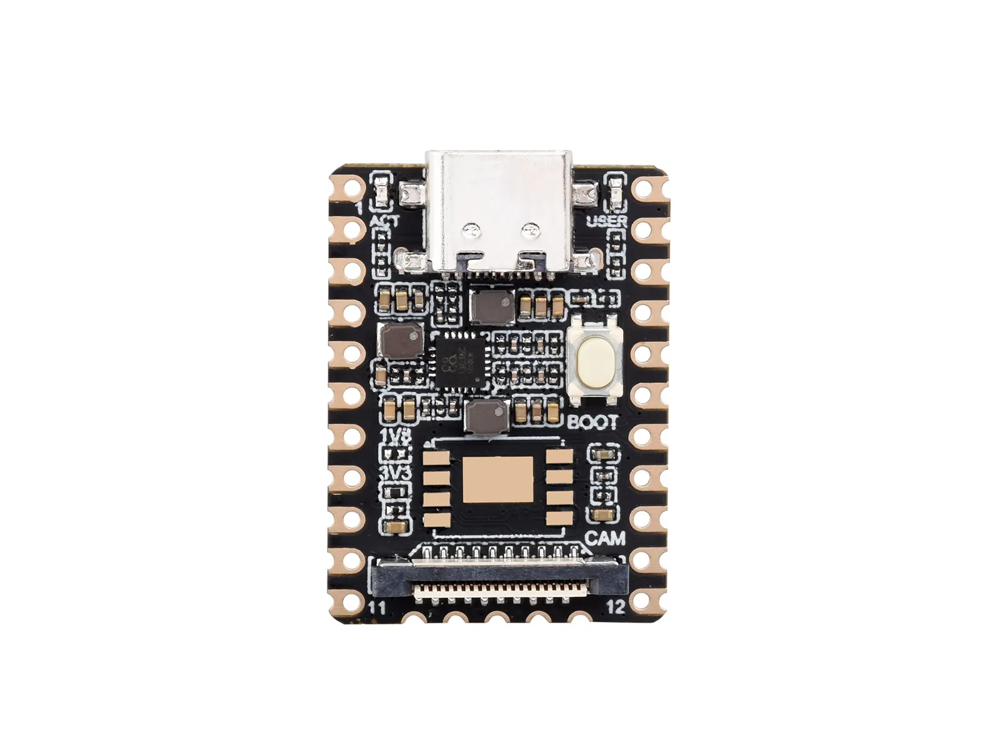
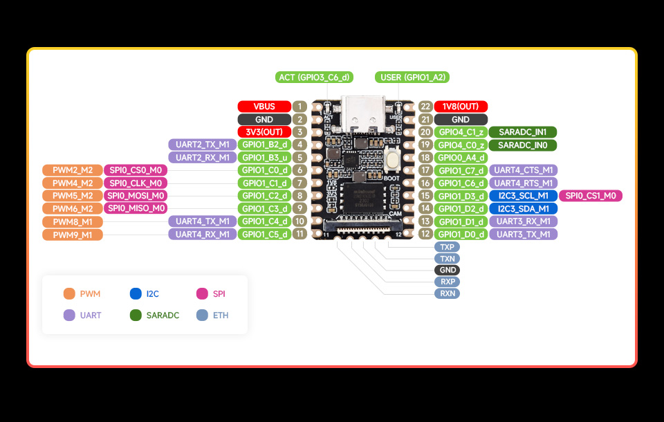
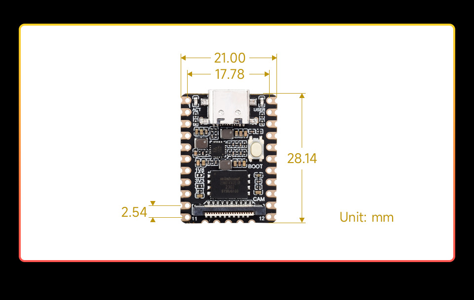

# Luckfox Pico Mini A

Source-grounded onboarding dossier for the RV1103 board and a battery-powered smart basket prototype.

> **Experimental, below L0.** The RV1103 chip and Mini A system descriptors declare CPU/memory geometry only; no board smoke firmware or peripheral implementation exists here. The native Cortex-A7 core prototype is a separate instruction fixture. It does not boot Linux or establish board support. See the [support rubric](../target_support_rubric.md), [chip scoreboard](../coverage/chip-conformance.md), and [validation record](../../examples/luckfox-pico-mini-a/VALIDATION.md).

## Status at a glance

| Item | Status |
|---|---|
| Exact hardware | [Luckfox Pico Mini A](https://www.luckfox.com/Luckfox-Pico-Mini-A?ci=536), not Mini B |
| Vendor silicon | RV1103; Cortex-A7, up to 1.2 GHz; 64 MB DDR2 |
| Storage | MicroSD boot; Mini A has no populated SPI NAND |
| Mechanical reference | 21.00 × 28.14 mm; 2.54 mm side-pin pitch |
| Local emulator | Optional native `qemu-arm` Cortex-A7 core experiment |
| Mini A target support | Below L0; Linux, peripherals and physical checks pending |

Hardware facts are from the [vendor variant overview](https://wiki.luckfox.com/Luckfox-Pico/Luckfox-Pico-RV1103/), [flash guide](https://wiki.luckfox.com/Luckfox-Pico-Plus-Mini/Flash-image/), and the drawings below.

Official **Mini A** product photograph. Download [original photograph](../assets/luckfox-pico-mini-a/product.webp); provenance and hashes are in the [source manifest](../assets/luckfox-pico-mini-a/sources.json).

## Flash / firmware artifact

For physical hardware, follow the vendor [MicroSD flash instructions](https://wiki.luckfox.com/Luckfox-Pico-Plus-Mini/Flash-image/) and select the **Mini A MicroSD** image. Record its download URL, version, SHA-256, board revision and serial boot log. No vendor OS image has been downloaded, flashed or booted as part of this dossier.

The official SDK is [LuckfoxTECH/luckfox-pico](https://github.com/LuckfoxTECH/luckfox-pico). Select the RV1103 Mini board and SD-card boot with the SDK's board selector; verify the resulting device tree is for Mini A (`rv1103g-luckfox-pico-mini-a.dts`). The [device-tree guide](https://wiki.luckfox.com/Luckfox-Pico-Pro-Max/Device-Tree/) lists Mini A and Mini B separately. A Linux application ELF is not the bare-metal ARM instruction fixture described below.

## Pins (board label → GPIO)

The vendor uses this **shared Mini A/B** illustration for the interface layout; its photographed board has a NAND package. It is not a photograph of the Mini A population. [Download original pinout](../assets/luckfox-pico-mini-a/pinout.jpg).

All 22 numbered side pads below were transcribed from this image. `_d`/`_z` suffixes are retained exactly as printed, without interpreting them as voltage ratings. Alternate functions require correct pinmux; they are not simultaneously active.

| Board pin | Printed rail / GPIO label | Alternate function shown |
|---:|---|---|
| 1 | VBUS | Board supply; see power integration notes |
| 2 | GND | Ground |
| 3 | 3V3(OUT) | Output rail; do not join to external 3.3 V regulator |
| 4 | GPIO1_B2_d | UART2_TX_M1 (debug console) |
| 5 | GPIO1_B3_u | UART2_RX_M1 (debug console) |
| 6 | GPIO1_C0_d | SPI0_CS0_M0; PWM2_M2 |
| 7 | GPIO1_C1_d | SPI0_CLK_M0; PWM4_M2 |
| 8 | GPIO1_C2_d | SPI0_MOSI_M0; PWM5_M2 |
| 9 | GPIO1_C3_d | SPI0_MISO_M0; PWM6_M2 |
| 10 | GPIO1_C4_d | UART4_TX_M1; PWM8_M1 |
| 11 | GPIO1_C5_d | UART4_RX_M1; PWM9_M1 |
| 12 | GPIO1_D0_d | UART3_TX_M1 |
| 13 | GPIO1_D1_d | UART3_RX_M1 |
| 14 | GPIO1_D2_d | I2C3_SDA_M1 |
| 15 | GPIO1_D3_d | I2C3_SCL_M1; SPI0_CS1_M0 |
| 16 | GPIO1_C6_d | UART4_RTS_M1 |
| 17 | GPIO1_C7_d | UART4_CTS_M1 |
| 18 | GPIO0_A4_d | No alternate function labeled |
| 19 | GPIO4_C0_z | SARADC_IN0 |
| 20 | GPIO4_C1_z | SARADC_IN1 |
| 21 | GND | Ground |
| 22 | 1V8(OUT) | Output rail; not a battery input |

The illustration also labels ACT as GPIO3_C6_d and USER as GPIO1_A2; these are not additional numbered header pads. Five separate bottom pads carry Ethernet TXP/TXN/GND/RXP/RXN. Neither analog-input electrical limits nor output-rail current capacity can be inferred from this image.

The [official schematic](../assets/luckfox-pico-mini-a/schematic.pdf) identifies the SARADC/PWM VCCIO2 domain as **1.8 V only**. Header pads **19/20 (GPIO4_C0/C1)** belong to that domain; do not apply 3.3 V or a battery voltage. The selected UART4/I2C3 connections use the separate 3.3 V domain. The schematic also requires SARADC_IN0 to remain pulled up; preserve that board function when considering pad 19. Absolute maximum ratings and ADC behavior still require the silicon documentation.

For the basket, reserve **14/15 for ADXL345 I2C3** and **10/11 for ESP-AT UART4**. Optional flow control uses **17 CTS / 16 RTS**. Preserve **4/5 UART2** for recovery and boot logs. See [complete wiring and power notes](../../examples/luckfox-pico-mini-a/HARDWARE.md). The vendor [I2C](https://wiki.luckfox.com/Luckfox-Pico-Plus-Mini/I2C/) and [UART](https://wiki.luckfox.com/Luckfox-Pico-Plus-Mini/UART/) guides corroborate the Mini A/B interface selection.

Shared vendor mechanical reference, not a manufactured carrier-board footprint. [Download original dimension diagram](../assets/luckfox-pico-mini-a/dimensions.jpg).

## Support matrix

| Capability | Status | Evidence boundary |
|---|---|---|
| Official pin / dimension / population references | ✅ | Documents and images, not electrical testing |
| Cortex-A7 arithmetic, ARM/Thumb and shared Bus access | ⚠️ | Native core fixture only; [prototype scope](../qemu-arm-core.md) |
| RV1103 reset, boot ROM and DDR initialization | ❌ | No board model |
| MMU, exceptions and interrupt delivery | ❌ | Not implemented by the core prototype |
| RV1103 clock, reset, GPIO, UART, timer and DMA | ❌ | No silicon-specific register models |
| RV1103 I2C3 connected to ADXL345 | ❌ | ADXL345 register kit exists; RV1103 controller and board transaction path absent |
| ESP-AT Wi-Fi bridge | ❌ | Selected UART architecture; no simulated or physical integration proof |
| MicroSD controller / Linux boot / NPU / camera | ❌ | No board execution evidence |
| Battery, charging, RF and enclosure | ❌ | Engineering proposal; no bench results |
| Browser / Playground / MCP execution | ❌ | Native core experiment has no browser support |

## What it catches vs bench

The separate core fixture can exercise a bounded instruction stream and shared memory-bus plumbing. It cannot validate an RV1103 Linux driver, boot sequence, serial FIFO timing, real Wi-Fi association, motion sensing, charging behavior or battery runtime. Those require the missing device models plus independent hardware measurements.

## How to run (CLI · Playground · MCP)

The [chip descriptor](../../configs/chips/rv1103.yaml), [system manifest](../../configs/systems/luckfox-pico-mini-a.yaml) and [example manifest](../../examples/luckfox-pico-mini-a/system.yaml) declare CPU and memory geometry. They do **not** provide a Mini A boot/run command. For the instruction-only experiment, use the native-feature commands and receipts in [QEMU ARM core prototype](../qemu-arm-core.md) with [`examples/cortex-a7-core`](../../examples/cortex-a7-core/). Its synthetic memory map is not the RV1103 memory map. Playground and MCP board execution remain unavailable.

## Related systems & examples

- [Onboarding package and implementation gates](../../examples/luckfox-pico-mini-a/README.md)
- [Hardware, power and interface design](../../examples/luckfox-pico-mini-a/HARDWARE.md)
- [Required vendor documents](../../examples/luckfox-pico-mini-a/REQUIRED_DOCS.md)
- [External components and model gaps](../../examples/luckfox-pico-mini-a/EXTERNAL_COMPONENTS.md)
- [Validation record](../../examples/luckfox-pico-mini-a/VALIDATION.md)
- [Board onboarding playbook](../board_onboarding_playbook.md)
