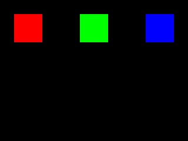

# Elecrow CrowPanel Advance 2.8-inch — minimal firmware pilot

**Target:** Elecrow DIS01728A, hardware V1.2, ESP32-S3-WROOM-1-N16R8, ST7789 SPI display (physical 320 × 240). This is a **first-stage integration test**, not a claim of production-ready, silicon-verified CrowPanel support.

The sketch uses the official V1.1/V1.2 [Elecrow LovyanGFX pin configuration](https://github.com/Elecrow-RD/CrowPanel-Advance-2.8-HMI-ESP32-S3-AI-Powered-IPS-Touch-Screen-320x240/blob/master/example/V1.1_and_V1.2/Arduino_Code/lesson-03/2.4_2.8_LVGL/LovyanGFX_Driver.h) but does not require LovyanGFX, LVGL or an extra library. It prints `CROWPANEL_UART_OK`, initializes the display, paints three RGB565 rectangles, then prints `CROWPANEL_DISPLAY_TRANSFER_OK`.

| Function | ESP32-S3 GPIO | Source |
| --- | ---: | --- |
| ST7789 SPI clock | 42 | Elecrow LovyanGFX |
| ST7789 SPI MOSI | 39 | Elecrow LovyanGFX |
| ST7789 chip select | 40 | Elecrow LovyanGFX |
| ST7789 data/command | 41 | Elecrow LovyanGFX |
| LCD backlight | 38 | Elecrow lesson-03 code |
| UART0 TX/RX | 43 / 44 | [Elecrow wiki](https://www.elecrow.com/wiki/CrowPanel_Advance_2.8-HMI_ESP32_AI_Display.html) |



The ST7789 model has **240 × 320** controller RAM; physical panel is **320 × 240** in landscape. Firmware sets MADCTL.MV to swap axes. No `glass_crop` is configured: unlike the reused 170 × 320 example, this panel uses all controller columns. Rotation/inversion must still be checked on real V1.2 hardware.

## Build the real firmware

```bash
pio run -d examples/elecrow-crowpanel-advance-28
```

PlatformIO's `esp32-s3-devkitc-1` build target supplies the same ESP32-S3 ISA and Arduino toolchain. The board-specific behavior here is defined by the GPIO assignments and `system.yaml`. The compiled image is **not** yet evidence of silicon equivalence.

Generate the 16 MB-layout flash image from the PlatformIO output:

```bash
bash examples/elecrow-crowpanel-advance-28/build_flash.sh
```

## Run in LabWired

From the `labwired-core` repository root:

```bash
LABWIRED_ESP32S3_FLASH=examples/elecrow-crowpanel-advance-28/.pio/build/crowpanel_advance_28/flash.bin \
  labwired run \
  --chip configs/chips/esp32s3.yaml \
  --system examples/elecrow-crowpanel-advance-28/system.yaml \
  --rom-boot \
  --firmware examples/elecrow-crowpanel-advance-28/.pio/build/crowpanel_advance_28/flash.bin \
  --max-steps 200000000 \
  --stop-on CROWPANEL_DISPLAY_TRANSFER_OK \
  --display-out examples/elecrow-crowpanel-advance-28/.pio/build/crowpanel_advance_28/display.ppm
```

**Evidence requirements:** verify the UART marker *and* that pixels reach the ST7789 framebuffer. A printed marker alone does not prove the SPI display worked. A real CrowPanel V1.2 hardware comparison is required before advertising tested support.

## Scope excluded from first pilot

Touch (I²C 0x38, GPIO15/16, INT GPIO47), speaker/audio, SD card, Wi-Fi/BLE, RF, battery/charger, display PWM and physical calibration. The available display simulator explicitly does not validate RES and BLK electrical behavior. These remain open until validated against the physical board.

Partnership tracker: [LabWired #1801](https://github.com/w1ne/labwired-core/issues/1801).

Re-run and negative control:

```bash
LABWIRED_BIN=/path/to/labwired bash examples/elecrow-crowpanel-advance-28/verify.sh
```
