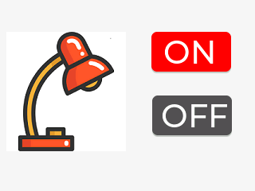

# Elecrow CrowPanel Advance 2.8 — ON/OFF lamp HMI

**Browser demo (compiled, runnable):** https://app.labwired.com/?share=a7wA8ut7SHGb&run=1

This is an **original, minimal Arduino HMI adaptation**, modeled after the function of Elecrow's [V1.1/V1.2 LVGL lamp ON/OFF lesson](https://github.com/Elecrow-RD/CrowPanel-Advance-2.8-HMI-ESP32-S3-AI-Powered-IPS-Touch-Screen-320x240/tree/master/example/V1.1_and_V1.2/Arduino_Code/lesson-03/2.4_2.8_LVGL). The actual vendor firmware was separately compiled and rendered in the **native** LabWired simulator, but the linked browser project runs **our small adaptation**, not their LVGL binary.

The target uses the board's real SPI signals, per Elecrow's LovyanGFX driver: **SCK42, MOSI39, CS40, D/C41, BL38**. The ST7789 driver renders a lamp illustration, ON button, and OFF button from real MCU SPI commands. Firmware prints `CROWPANEL_HMI_READY`; setting ON changes the lamp to yellow and raises GPIO18, while OFF restores gray and clears GPIO18.

## How to try the browser lab

1. Open the URL above, and click **Run** if the lab is paused.
2. Select `touch_on_proxy` in the input parts list. Click and **hold Tap** (or press the button on the canvas). The lamp image changes from gray to yellow.
3. Select `touch_off_proxy` and press **Tap**. The lamp changes back to gray.

**Important:** the two virtual pushbuttons are test-only *substitutes* for the capacitive touchscreen, not physical CrowPanel components. They stimulate firmware GPIO9/GPIO10. Real Elecrow touch input uses an I2C touch IC and still needs a matching device model and R&D validation.

This lab uses `st7789-170x320` as a generic ST7789 controller stand-in with a full 240×320 controller RAM. The **native** simulator renders all 320×240 landscape pixels, but the current web renderer still applies the legacy 170-pixel glass crop. The browser preview therefore shows only 320×170 until a dedicated 240×320 ST7789 display representation is released. Do not describe this as a complete physical-device simulation yet.

## Actual screenshots (not mockups)

* [Vendor's original LVGL lamp UI rendered by the native LabWired simulator](images/official-elecrow-lvgl-sim.png)
* [Our original browser-compatible HMI at startup, as rendered by the native simulator](images/onoff-hmi-off-sim.png)



## Build

From the `labwired-core` repository root:

```bash
pio run -d examples/elecrow-crowpanel-advance-28/hmi
```

`system.yaml` defines actual board display wiring plus test-only button proxies. The full vendor LVGL build requires LovyanGFX, LVGL9 and TAMC_GT911 and was compiled and simulated separately; this original adaptation uses only Arduino/SPI to keep the browser example self-contained.

## Technical evidence

See [VALIDATION.md](VALIDATION.md) and the [CrowPanel pilot issue](https://github.com/w1ne/labwired-core/issues/1801). Native display output, browser ON/OFF input transitions, and known gaps are recorded there. Physical V1.2 board verification has not occurred.
