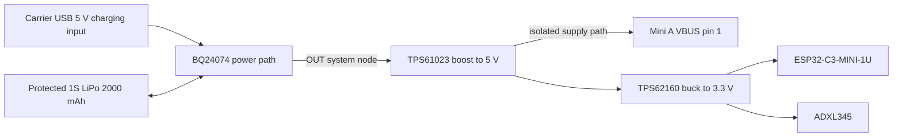

# Smart basket hardware notes

This is the proposed carrier integration for the exact Mini A. No schematic for the complete carrier, PCB, fitted battery, firmware image or physical measurements have been produced. Component selection and interfaces are fixed here; supporting values and assembly qualification remain open.

## Wi-Fi: ESP32-C3-MINI-1U over UART4

Use a 4 MB MINI-1U variant compatible with the selected ESP-AT release and an external 2.4 GHz antenna. The [module datasheet](https://www.espressif.com/sites/default/files/documentation/esp32-c3-mini-1_datasheet_en.pdf) distinguishes MINI-1U's antenna connector from MINI-1's PCB antenna. Record the exact module ordering code, antenna part, connector/cable assembly and firmware hash before assembly.

The [ESP-AT hardware guide](https://docs.espressif.com/projects/esp-at/en/latest/esp32c3/Get_Started/Hardware_connection.html) uses **UART1** for commands, separate from download/log UART0. Default command GPIOs are RX6/TX7/CTS5/RTS4; confirm against the [released firmware table](https://docs.espressif.com/projects/esp-at/en/latest/esp32c3/AT_Binary_Lists/esp_at_binaries.html) or the actual custom build. Start with 115200 baud, 8N1; use a buffered, bounded command parser that handles unsolicited responses and partial reads.

| Mini A connection | ESP32-C3 GPIO | MINI-1U module pad | Role |
|---|---:|---:|---|
| Pin 10 / UART4_TX_M1 | 6 | 20 | Host TX → ESP AT RX |
| Pin 11 / UART4_RX_M1 | 7 | 21 | ESP AT TX → host RX |
| Pin 17 / UART4_CTS_M1 | 4 | 18 | ESP RTS → host CTS, optional |
| Pin 16 / UART4_RTS_M1 | 5 | 19 | Host RTS → ESP CTS, optional |
| Common ground | — | All required GND pads | Ground reference |
| Carrier 3.3 V | — | 3 / 3V3 | External supply |

Flow control requires UART4 pinmux, host driver configuration and ESP firmware configuration together. Leave it disabled in both ends until verified. Module-pad numbers are from the Espressif datasheet, not connector positions on an arbitrary breakout. Do not connect to ESP GPIO20/21 as if those were the AT command port.

Provide EN pull-up/reset circuitry, the documented boot straps, a separate download/log header and local decoupling according to Espressif's hardware guidance. The carrier's UART pins must remain high impedance while either endpoint is unpowered, or use suitable isolation to prevent phantom power. Keep the external antenna away from basket metal, battery, switching inductors and human handling; test the assembled position and orientation.

The proposed host software opens UART4 (normally `/dev/ttyS4` once enabled in the vendor image), requests station association and sends application socket traffic with ESP-AT. This is serial network offload. It does not provide a Linux WLAN interface. Firmware feature selection, secure transport limits, reconnect behavior and bandwidth must be verified for the actual ESP-AT build. An eventual simulator AT peer would test protocol handling, not RF or real network availability.

## Motion: ADXL345 on I2C3

The [ADXL345 datasheet](https://www.analog.com/media/en/technical-documentation/data-sheets/adxl345.pdf) is the electrical/register source. Use the carrier 3.3 V for both sensor supply and I/O, with local decoupling. Tie CS high for I2C. Tie SDO low for address **0x53** (high selects 0x1D); do not leave it floating. Connect SDA to Mini A **pin 14 / GPIO1_D2**, SCL to **pin 15 / GPIO1_D3**, with pull-ups to the sensor's 3.3 V domain. Start at 100 kHz with short carrier traces and choose pull-up values from bus capacitance and measured rise time.

Read DEVID register 0x00 and expect **0xE5** before enabling measurement. A proposed first capture uses 100 Hz, full-resolution ±2 g and timestamped XYZ samples; choose final range/rate from measured basket vibration and impact. Mount the sensor rigidly, document axis orientation, measure offsets and compare stationary/tilted/moving cases. An accelerometer alone detects motion or tilt; it does not prove item identity, weight or basket inventory.

Start with polling; any INT1/INT2-to-GPIO assignment and interrupt policy require a separate reviewed pinmux decision. Motion-triggered wake of a powered-down Linux host is not provided by this wiring. LabWired already contains the [ADXL345 I2C register kit](../../configs/devices/adxl345.yaml), with DEVID/XYZ read tests and acceleration inputs in g. RV1103 I2C3 controller/pinmux integration, a complete basket scenario and physical data replay remain unimplemented.

## Battery and power tree

Selected energy source: **protected 1S, 3.7 V nominal, 2000 mAh LiPo**, with compatible 4.2 V charge termination. Select an actual pack with documented discharge current, permitted charge current, protection thresholds, thermistor, connector polarity and mounting limits before constructing the carrier. The charger is not a substitute for pack protection.

The [BQ24074](https://www.ti.com/product/BQ24074) provides single-cell charging and load sharing. Feed both downstream converters from **OUT**, not directly from BAT, so the charger can distinguish charging current from the system load. Set input and charge limits using its datasheet and the actual USB source/pack; thermal dissipation and low-source-current operation still need qualification. Wire TS to the selected pack thermistor and retain charge timeout/status behavior.

The [TPS61023](https://www.ti.com/product/TPS61023) produces 5 V for Mini A. Its advertised 3.7 A figure is a **switch current limit**, not guaranteed 5 V output current. Select inductor, feedback divider, capacitors and layout from the vendor reference circuit, then measure startup and peak load at the lowest permitted battery voltage.

Feed the [TPS62160](https://www.ti.com/product/TPS62160) from that **regulated 5 V**, not directly from the cell: a buck cannot maintain 3.3 V after the battery falls below that level. Set its output to 3.3 V and qualify radio-burst transients against the module's supply limits. Keep Mini A **pin 3 (3V3 OUT)** and **pin 22 (1V8 OUT)** separate from these external regulated rails.

Mini A USB-C VBUS and carrier supply behavior must be checked against the [official Mini schematic](../../docs/assets/luckfox-pico-mini-a/schematic.pdf) before connecting a host cable while boosted power is active. Provide a reviewed power mux / reverse-blocking arrangement, or isolate the USB data connector's VBUS in the carrier integration. Two live 5 V sources must not be directly joined. The diagram identifies the required isolated supply path; it does not claim isolation components are already selected.

Provide an orderly Linux shutdown before pack protection trips, then disable the boost with an independent hardware controller/latch that does not depend on software after power removal. Battery voltage measurement, thresholds, hysteresis, switch/latch circuit and charging wake behavior are open design work. Direct LiPo connection to GPIO, ADC or 3.3 V output pins is invalid; an ADC divider requires confirmed RV1103 analog limits.

The official Mini schematic marks the SARADC/PWM VCCIO2 domain **1.8 V only**: pads 19/20 (GPIO4_C0/C1) must not receive 3.3 V. It also requires SARADC_IN0 to remain pulled up. The chosen UART/I2C pins belong to the separate 3.3 V domain; their level does not establish a board-wide GPIO voltage rating.

## Energy estimate and physical acceptance

Nominal stored energy is **3.7 V × 2 Ah = 7.4 Wh**. A planning estimate is `runtime ≈ 7.4 Wh × usable_fraction × path_efficiency / average_load_W`. For example, assuming a combined factor of 0.8 and 2 W average load gives about 3 hours. Those are assumed numbers, not measured runtime or guaranteed pack capacity. CPU activity, Wi-Fi bursts, boot time, regulator losses, cutoff reserve, temperature and aging change the result.

Before use, measure 5 V/3.3 V startup, USB attach/detach, Wi-Fi transmit bursts, battery-low behavior, charge termination under load and charger/converter temperatures. Confirm no reverse current between power sources and no signal-driven phantom power. Check runtime using the final OS, sensor rate, radio duty cycle, antenna and enclosure.

The vendor shared drawing specifies 21.00 × 28.14 mm, 17.78 mm row spacing and 2.54 mm pitch. It does not dimension the first pad center from the top edge or every pad shape. Use official CAD where applicable and verify against the real board before ordering a footprint. Provide USB-C and camera-connector clearance, battery restraint and antenna cable strain relief; final enclosure/CAD is not part of this documentation evidence.
